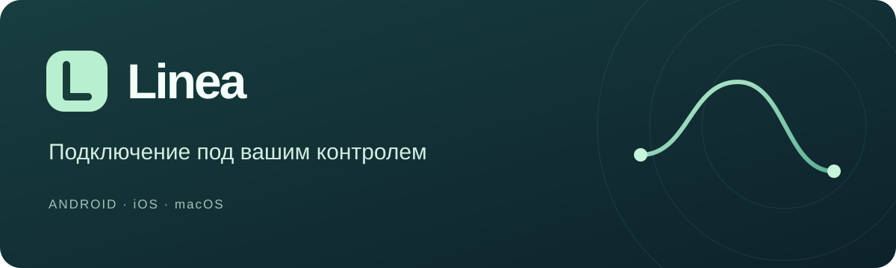
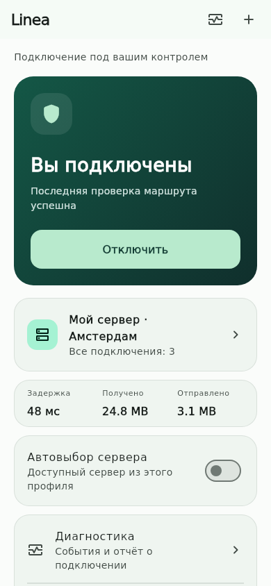
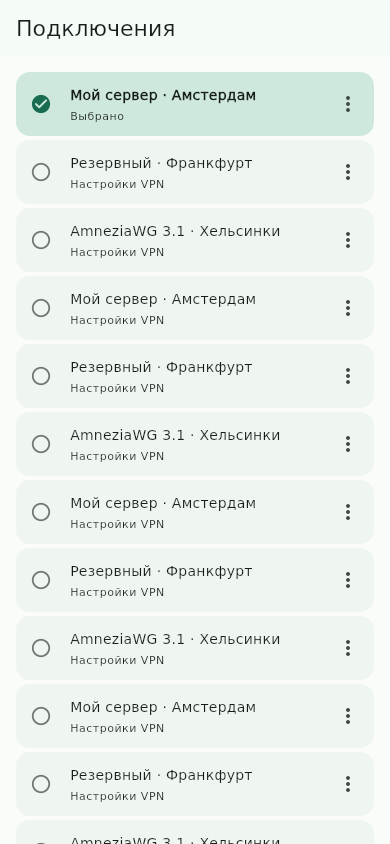
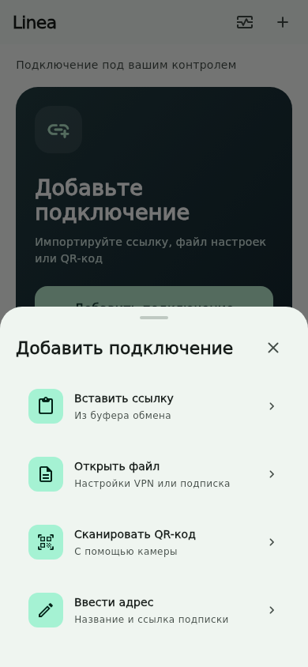

<p align="center"></p>
<p align="center">
  <a href="https://github.com/Saborrr/linea-connect/actions/workflows/linea-android.yml"></a>
  <a href="https://github.com/Saborrr/linea-connect/actions/workflows/linea-checks.yml"></a>
  
  <a href="LICENSE.md"></a>
</p>
<p align="center"><b>Русский</b> · <a href="README.en.md">English</a></p>
<p align="center"><a href="#начать">Начать</a> · <a href="#интерфейс">Интерфейс</a> · <a href="#протоколы">Протоколы</a> · <a href="#разработка">Разработка</a></p>

Открытый клиент для подключения к своему VPN-серверу, в том числе через подписку из **3x-ui**. Один главный экран, компактный список подключений и диагностика, которую можно выгрузить после сбоя.

> **Development 0.2.0.** Android APK собирается в GitHub Actions. Для iPhone и Mac предусмотрены сборки без подписи. Подключение к вашему VPS и работа в сети вашего оператора требуют проверки на устройстве.

## Начать

**[Сборки Android и скачивание APK →](https://github.com/Saborrr/linea-connect/actions/workflows/linea-android.yml)**

1. Откройте последний **успешный** запуск и скачайте `Linea-Android-development` в разделе **Artifacts**. Для скачивания нужен вход в GitHub.
2. Распакуйте архив и установите `app-debug.apk`.
3. Добавьте ссылку из панели, файл конфигурации или QR-код. Выберите подключение и нажмите **Подключить**.

Новая ссылка добавляется в список. Повторный импорт **того же адреса подписки** обновляет его содержимое. При добавлении другого адреса выбранное подключение по умолчанию сохраняется.

Для работы нужна собственная конфигурация. Приложению не нужны пароль администратора 3x-ui и SSH-доступ к серверу.

## Интерфейс

<p align="center">
  
  
  
</p>

*Превью получены из Flutter-виджетов на тестовых данных. Это не измерения реального сервера.*

| На каждый день | Когда нужны подробности |
| --- | --- |
| Одна кнопка подключения | Последняя проверка маршрута, задержка и трафик |
| Компактный список сохранённых профилей | Выбор сервера внутри подписки |
| Импорт из буфера, файла и камеры | Экспорт диагностики и ошибок прошлого запуска |
| Полные подписи и прокрутка | Поддержка увеличенного системного шрифта |

## Протоколы

| Возможность | Состояние |
| --- | --- |
| **AmneziaWG 3.1** | Официальное ядро `v3.1.20260828`; передаются защита заголовков, RandomTrailers, DisableCookies, диапазоны таймингов и дополнения пакетов. Проверяются импорт, native IPC и TCP/UDP-туннель |
| **AmneziaWG 2.0** | Обратная совместимость; Jc/Jmin/Jmax, S1–S4, H1–H4 и I1–I5. Есть отдельная проверка туннеля |
| VLESS / REALITY / Vision / XHTTP | Адаптеры унаследованного Hiddify Core. Совместимость конкретного профиля проверяется при импорте и подключении |
| VMess / Trojan / Shadowsocks | Унаследованные адаптеры ядра |
| Hysteria2 / TUIC / WireGuard | Требуются совместимые параметры сервера и доступный UDP |

AmneziaWG импортируется из `.conf`, `awg://` и JSON endpoint. Неизвестные параметры и ошибочные числа отклоняются: они не должны молча исчезать при преобразовании. Для нескольких AWG peers используйте JSON endpoint.

[Полная матрица и ограничения →](docs/linea/PROTOCOLS.md) · [Как устроена интеграция AWG 3.1 →](docs/linea/AMNEZIAWG.md)

## Платформы

| Платформа | Что доступно |
| --- | --- |
| Android | Development APK для испытаний |
| iPhone / iOS | Исходники приложения и Packet Tunnel; для установки нужны свои подпись и provisioning profiles |
| Mac / macOS | Исходники и workflow компиляции; для распространения нужны подпись и notarization |

[Сборка и подпись →](docs/linea/BUILD.md)

## Диагностика и приватность

Отчёт содержит категории событий, время, версию приложения и место ошибки в исходниках. Ошибки сохраняются между запусками; на Android 11+ добавляются числовые сведения о последнем завершении процесса. URL подписок, ключи, текст конфигурации и произвольные сообщения в отчёт не включаются.

Перед добавлением подключения приложение не опрашивает остановленную VPN-службу. Профили хранятся локально; защищённое хранилище остаётся отдельной задачей. [Подробнее →](docs/linea/PRIVACY.md)

## Автовыбор и ограничения сети

Автовыбор использует группу `urltest` из текущей подписки. Он переключает доступные серверы этой группы. Это ещё не полноценное определение «белых списков» оператора: новая адаптивная политика протестирована отдельно, но пока не подключена к фоновым VPN-службам.

Доступность зависит от сервера и сети. Имя приложения и наличие нового протокола сами по себе не гарантируют соединение.

## Разработка

Flutter **3.38.5** · Dart **3.10.4** · Go **1.26.3** · Java **17**

```sh
make common-prepare
flutter test
dart tool/linea_checks.dart

# Закреплённое ядро и проверки настоящего AWG-туннеля
bash tool/native/prepare-core.sh
bash tool/native/test-core.sh hiddify-core/source
```

Версии native core и AmneziaWG закреплены в [`core.lock.json`](tool/native/core.lock.json). Android workflow собирает библиотеку из исходников с патчем адаптера, затем APK. Изменяемый upstream `draft` в этом workflow не используется.

[Архитектура](docs/linea/ARCHITECTURE.md) · [Проверки](docs/linea/VALIDATION.md) · [Планы](docs/linea/ROADMAP.md) · [Анализ рынка](docs/linea/MARKET_RU.md)

## Основа проекта

Linea основана на [Hiddify](https://github.com/hiddify/hiddify-app), снимок `4b99aa681d36aae104c440a9557a71dd93382ba3`. [Оригинальный README](README.upstream.md) сохранён. Это самостоятельный производный проект; он не выпускается командой Hiddify или Amnezia.

Лицензия приложения: [Hiddify Extended GNU GPL v3](LICENSE.md), включая ограничения коммерческого использования. Лицензии компонентов сохраняются; исходники используемого ядра и патч доступны в репозитории и сборочном процессе.
